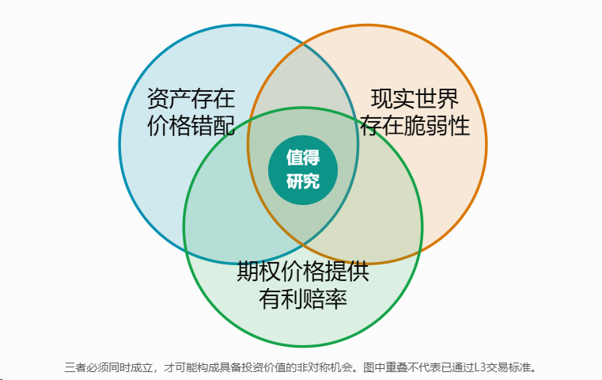

# 反脆弱投资 Agent

**Antifragile Investment Agent · 从寻找价值洼地，到发现尚未被市场充分定价的未来。**

一个基于 Python、LangGraph 和持久化事件记忆的多智能体投资研究、模拟决策与历史评测系统。它尝试把新闻、产业结构与价格异常连接起来，在事件兑现前研究潜在路径，再用期权成本检验参与机会需要付出怎样的代价。

[快速开始](#快速开始) · [三个案例](#三个案例如何推动系统演进) · [当前能力](#目前能够做什么) · [API 分工](#数据与模型各自负责什么) · [架构](#系统怎样构建) · [设计原文](docs/project-vision.md) · [交流](#交流与参与)

## 为什么做这个项目

项目来自作者对投资、不确定性和有限本金下财富增长方式的思考。2026 年 11 月初，作者开始把塔勒布的反脆弱思想，与复杂系统中的吸引子、控制论联系起来。

最初的研究问题是，资金、资源、需求和注意力正在向哪里聚集？哪些资产的价格尚未反映新的结构性力量？随后，黄金、原油和英伟达三个案例又带来了新的问题。

便宜的资产可能长期便宜。现实冲击可能被替代供给或政策吸收。判断对方向，也可能因事件发生太晚、权利金太贵或没有退出报价而亏损。因此，系统同时研究资产、事件、时间和参与成本。

**最终产品目标是主动发现有现实依据、能够解释价格传导、具有有限损失结构，并值得进一步核验的非对称投资机会。**

## 什么样的机会值得研究

| 条件 | 系统需要回答的问题 |
|---|---|
| 资产可能存在价格错配 | 与哪个经济参照相比？长期价值锚是否变化？历史关系是否已经失效？ |
| 现实世界存在脆弱性 | 哪个节点容易受阻？谁能决定结果？替代和恢复需要多久？ |
| 期权可能提供有利赔率 | 事件能否在到期前发生？价格变化是否足够？成本、流动性和退出条件是否允许参与？ |

三者交集中的“值得研究”是候选资格。要形成模拟买入方案，还需要独立证据、可信报价、保守净期望、风险预算及反证检查。

## 目前能够做什么

当前版本为 V3.2 本地研究原型，提供三个功能区。

| 功能区 | 可以执行的操作 | 获得的结果 |
|---|---|---|
| **机会猎场** | 手动扫描、资产或事件定向研究、更新已有机会、判断机会是否值得承担成本 | 有来源的研究报告、中文新闻摘要、三类情景、条件赔率与具体数据缺口 |
| **案例区** | 一键多轮回放、失败续跑、独立验证、TXT 编辑与上传 | 各时点锁定的判断与模拟决策、分项评测、按真实步骤着色的流程图 |
| **灵石区** | 配置和测试接口、启停数据源、查看调用和 Token、调整预算与调度 | 数据源状态、权限与时效提示、积分和调用量记录 |

已经实现的基础能力包括以下内容。

- **两条发现路径**。从行情异常寻找原因，也从新闻寻找相关资产。首发 12 个重点行情标的包含美股、股指 ETF 和商品代理，池外关联依赖来源中的标的标识与事件匹配。
- **跨天记忆**。保存事件 ID、原始材料或摘要、来源、时间戳、旧判断、未解决矛盾及版本。新研究读取有关历史和增量，旧记录继续保留。
- **证据与概率校验**。模型引用必须对应当轮材料，未知概率保留未知，独立概率快照先于赔率比较保存。
- **单腿多头 Call / Put 计算**。Python 计算权利金、费用、最大损失、保本价、情景净损益、净期望区间、概率门槛及条件权利金上限。
- **时间与预算控制**。区分历史、延迟和当前报价，保存缓存与预算预留。资料缺失、权限不足或校验失败会给出原因。

新闻发现范围受查询和 Provider 覆盖限制。部分网页的价格提取仅支持可核对的公开结构化字段，完整历史盘中数据、资金流和期货期限结构仍有缺口。真实自动交易处于范围之外。

### 已验证到哪一步

2026 年 11 月 24 日的验收记录包含 **43 项自动化测试通过**，以及黄金 5 轮、原油 5 轮、NVDA 4 轮真实模型回放完成。14 轮均锁定预测并生成独立评分，时间隔离与模拟决策流程检查通过，重启和备份恢复后记录保留。

三案当前均为 L1 观察，缺少可验证的历史期权成交闭环。案例中的用户设定、参考报价和假设收益分别标记。分项均分只覆盖有资料可检查的项目，不能代表整体预测正确率或投资收益。

详见 [V3.2 最终验收记录](docs/v32-stageF-acceptance.md)和[案例资料覆盖说明](docs/v32-stageE-acceptance.md)。三案参与过系统设计，后续还需要样本外事件、未兑现事件、期权归零及未成交案例验证。

## 三个案例如何推动系统演进

### 黄金 → 谁正在成为新的定价力量

黄金研究最初来自投资播客，关注央行储备配置、货币信用、ETF 流入与金融投资者的边际定价作用。它推动系统从“资产是否便宜”，进一步研究长期价值锚是否迁移，以及价格和资金流如何相互强化。

黄金也暴露出执行问题。事后找到高倍数期权成交样本，仍需要核对当时的 Bid / Ask、流动性、期限和退出条件。由此加入资金确认、分级信号、过热检查与退出研究。

内置回放有 **5 轮**。材料包含世界黄金协会的央行需求和 ETF 报告摘要，部分后续轮次仍以待补充资料的研究任务推进。GLD 历史期权双边报价尚待补齐。

### 原油 → 在危机兑现前推演传导链

原油研究把系统从长期重定价扩展到离散事件。原油相对沪深 300 约 30% 的背离作为待验证假设，要求检查同步口径、经济解释与结构变化。

围绕霍尔木兹海峡，研究进一步追问运输、保险、库存、减产、替代供应和储备释放如何影响价格。由此形成从资产异常和世界事件出发的两条发现路径，并加入产业网络瓶颈、行动树与正负反馈分析。

内置回放有 **5 轮**。布伦特、WTI、USO 及其期权分别处理；EIA 事后回顾放入独立验证材料。军事与外交前兆的历史归档、价差假设和 USO 报价仍有缺口。

### 英伟达 → 把事件判断变成时间与赔率问题

NVDA 案例推动系统分析新闻矛盾，以及决定权、否决权和影响力之间的区别。某个主体公开施压，与董事会正式改变决定，是不同的证据节点。

它也暴露出“识别催化剂之后如何判断成本”的问题。系统因此比较到期日、事件发生窗口和足够价格变化的联合条件，先保存独立判断，再检验期权要求的概率门槛，并在催化兑现后重新检查退出条件。

内置回放包含周五 15:55、周日夜间、周一开盘和收盘后的 **4 轮**。其中部分新闻与价格来自用户测试设定，另有当前检索到的公司公告；历史可见版本、具体时分和个人成交尚未完整核验。

例如，**假设** 150 美元 Call 的 Ask 为 0.62 美元、合约乘数为 100，成本为 62 美元。若成功时到期股价为 160 美元，期权到期价值为 1,000 美元；失败时归零，忽略费用的二元盈亏平衡概率为 6.2%。这表示该假设模型要求的概率门槛，实际事件概率需要另外估计。假设以 18 美元卖出时，未计费用利润为 1,738 美元；个人实际收益需要成交记录支持。

作者关于三个案例的完整思考、理论来源与演变过程保留在[项目源起与设计理念原文](docs/project-vision.md)。

## 使用了哪些思想

| 思想与来源 | 在研究中的作用 | 需要检验的边界 |
|---|---|---|
| **反脆弱**，塔勒布《反脆弱》《黑天鹅》 | 寻找有限损失、潜在非对称回报的参与结构 | 累计失败、权利金消耗及费用必须纳入长期统计 |
| **吸引子**，复杂系统与动力系统的启发 | 研究资金、需求、制度与技术变化，以及新的边际定价者 | 价值锚需要经济解释，目标价和均衡迁移仍有不确定性 |
| **控制论**，反馈与状态转移 | 推演价格、库存、产量、政策和流动性的放大与稳定机制 | 同时研究替代路径、缓解措施与恢复时间 |
| **捕蝇草机制**，生物机制的类比 | 积累独立信号，分级升级研究优先级 | 同一新闻转载只算一条，反证可以使信号降级 |
| **相对价值** | 用同步收益、相关性、残差和分位发现背离 | 走势相似需要结合经济关系与结构突变解释 |
| **新闻矛盾与权力结构** | 跟踪谁说了什么、谁实际行动、谁有决定权与否决权 | 传闻、声明、事实和模型推断分别标记 |
| **产业网络与极端情景** | 寻找供应链、运输及金融网络关键节点，推演行动与反制 | 关注瓶颈、替代、恢复和价格传导的现实依据 |
| **赔率反推与概率决策** | 把事件、时间、价格反应转为成本和概率门槛 | 概率先独立锁定，风险中性概率与事件概率分别解释 |

这些思想构成研究框架，实际判断通过证据、Python 计算和历史审计接受检验。

## 数据与模型各自负责什么

接口统一在灵石区配置，认证信息由服务端保存，页面显示脱敏状态。

| Provider / 工具 | 职责 | 当前接入情况 |
|---|---|---|
| **OpenAI 兼容模型接口** | 证据理解、因果和情景推演、中文翻译 | 支持兼容 Chat Completions 的服务，已适配 DashScope；不同供应商仍需单独测试 |
| **Tavily / Brave Search** | 新闻、政策、公告、产业资料及公开报价线索检索 | 已有两种适配；真实联调使用 Tavily，公开网页结构化价格提取覆盖有限 |
| **Alpaca** | 美股、ETF、商品代理基础行情及历史日线 | 已验证 IEX 行情；Alpaca 新闻是独立可选接口 |
| **MarketData.app** | 到期日、有限期权链、OCC 单合约和历史日终报价 | 已验证真实账户接入，缓存、积分预算和实际时间戳分别保存 |
| **Massive** | 旧期权 Provider 兼容接口 | 接口保留，当前主要流程使用 MarketData |
| **Python** | 去重、日期、金融数学、预算、风险规则及评分 | 确定性计算由程序执行，模型负责需要语义理解的部分 |

MarketData 免费与试用账户的权限、延迟及历史范围以实际响应和官方政策为准。本项目试用接入记录为至少 24 小时延迟、最近一年历史范围。查询成功后仍需核对实际报价时间；历史日终数据不会释放给当天收盘前的模拟。积分消耗和请求次数分别统计。[MarketData 账户说明](https://www.marketdata.app/docs/account/free-accounts/)

GLD、USO、UNG、CPER 是黄金、原油、天然气、铜的证券代理。系统分别标记现货、期货、ETP 份额及具体期权合约的口径，报价使用相应的币种、单位、复权与时间。

## 系统怎样构建

后端采用 **FastAPI + Pydantic**，研究编排采用 **LangGraph**，存储采用 **SQLite**，前端为原生 **HTML / CSS / JavaScript**。后台任务和轻量调度支持手动研究、可选定时扫描及回放续跑。

    手动扫描或事件更新
      → 采集数据并读取事件记忆
      → 价格异常与新闻线索筛选
      → 因果研究与三类情景
      → 锁定独立概率与时间窗口
      → 市场预期检查与有限期权查询
      → Python 赔率、反证与风险检查
      → 保存报告、模拟判断与数据缺口
      → 新证据出现后继续更新

现实研究图包含筛选、综合研究、概率锁定和市场预期四个主要节点。期权采集、数学与退出判断通过外围 Python 流程连接。历史回放使用隔离时钟与案例数据，复用研究推理和赔率函数，全部轮次锁定后由独立审计模块打开验证材料。案例页提供两张按实际执行状态着色的流程图。

### 13 个逻辑研究模块

| 模块 | 责任 | 模块 | 责任 |
|---|---|---|---|
| A0 | 数据与证据管理 | A1 | 机会扫描 |
| A2 | 相对价值 | A3 | 吸引子与定价力量 |
| A4 | 新闻雷达与矛盾 | A5 | 产业网络 |
| A6 | 博弈与权力结构 | A7 | 情景概率与时间 |
| A8 | 反馈控制 | A9 | 市场预期 |
| A10 | 期权估值与赔率反推 | A11 | 风险、反证与退出 |
| A12 | 历史评测与审计 | | |

逻辑职责可以合并为一次模型请求，避免为每个编号重复发送上下文。模型只看到当轮允许的材料，引用、结构和概率约束由程序检查。

信号从 L0 日常观察，逐步进入 L1 异常、L2 催化确认、L2.5 赔率候选和 L3 模拟买入候选。R1、R2、R3 分别记录停止追仓、研究兑现及退出条件。L3 需要通过报价时效、流动性、期限、风险和反证条件。

### 计算与记忆

净期望收益按各情景概率与可实现期权价值之和，扣除权利金和费用计算。简化二元模型的门槛为以下公式。

    盈亏平衡成功概率
    = (总成本 − 失败情景价值) / (成功情景价值 − 失败情景价值)

系统分别考虑事件发生、到期前发生并公开、足够价格变化以及目标退出条件。标准单腿多头 Call / Put 是第一版的研究范围。缺少合约乘数时，参考计算会明确列出标准 100 份假设，并等待交割条件确认。

事件、证据、判断版本、独立概率、研究检查点、历史报价和模拟决策持久化保存。案例输入、验证答案与预测记录分库隔离，生产事件与案例记忆分别管理。

## 快速开始

需要 Python 3.11 或以上版本。以下命令适用于 Windows PowerShell。

    git clone https://github.com/renduermai/Antifragile-Multi-Agent-System-.git
    Set-Location Antifragile-Multi-Agent-System-
    python -m venv .venv
    .\.venv\Scripts\python.exe -m pip install -r requirements.txt
    .\.venv\Scripts\python.exe -m uvicorn app.main:app --host 127.0.0.1 --port 8765

打开 [本地工作台](http://127.0.0.1:8765/)，API 文档位于 [本地接口文档](http://127.0.0.1:8765/docs)。

1. 进入灵石区配置实际可用的模型、搜索、行情和期权接口，分别测试权限。
2. 在机会猎场采集数据、扫描或定向研究。手动采集本身不调用研究模型。
3. 打开候选，核对证据、情景和反证，再点击成本判断按钮。
4. 在案例区选择历史案例，查看资料覆盖后开始回放。旧结果读取与新运行分别处理，新运行会产生实际接口消耗。

密钥保存在服务端数据目录的 secrets.json，本地目录已加入 Git 忽略。可通过 AF_DATA_DIR 指定数据路径。接口未配置时页面给出提示，可用模块继续运行。

定时扫描默认关闭。模型次数、搜索请求及 MarketData 积分有各自预算。新安装使用代码默认预算，可在灵石区调整；开发验收实例的 200 次每日模型上限属于本机配置。案例页按最长五轮估算剩余完整回放次数，重试与其他研究共享调用额度。

## 测试、目录与维护

    .\.venv\Scripts\python.exe -m pytest -q

自动化测试使用临时数据库与明确标记的测试材料。覆盖数据源异常、证据版本、跨天续采、预算、缓存、概率锁定、期权数学、历史时间隔离、回放恢复及备份恢复。最新结果与运行范围请查验收文档。

    app/
      providers.py, collection.py       数据接口与采集
      scanning.py, hypotheses.py       研究图与结构化推理
      marketdata.py, option_sources.py 期权接口及搜索降级
      options.py, expectations.py      数学、风控与市场资料
      case_*.py, replay.py             历史预测、验证及自动回放
      db.py, backup.py, scheduling.py   存储、备份与调度
      web/                            三个功能区
    cases/                            分开的案例与验证资料
    config/                           带版本的研究和期权规则
    tests/                            可运行测试
    docs/                             思想原文、设计和验收记录

- [案例 TXT 与验证格式](docs/stage5-cases.md)
- [MarketData 接入与实际权限](docs/v32-stageB-acceptance.md)
- [赔率与搜索降级](docs/v32-stageC-acceptance.md)
- [中文体验与持续跟踪](docs/v32-stageD-acceptance.md)
- [案例与流程图](docs/v32-stageE-acceptance.md)
- [最终测试及备份恢复](docs/v32-stageF-acceptance.md)

## 演进方向与最终产品目标

项目依次从黄金中的定价力量迁移，发展到原油中的相对错价、网络瓶颈与极端事件，再发展到 NVDA 中的新闻矛盾、权力结构和事件—时间—赔率联合判断。V3.2 把这些能力整理成可以使用、持续更新和回放检查的产品流程。

接下来的研究重点包括完善事前历史资料、可靠盘中报价与池外关联，补充天然气、铜、稀土和流动性危机案例，开展样本外测试，并统计未兑现、归零、未成交和判断错误带来的全部成本。概率校准与长期净期望需要足够多的独立观察。

最终希望实现的闭环是，主动观察世界，发现尚未充分定价的变化，在证据积累中更新判断，用实际参与成本检验机会，并通过持续审计发现自己的错误。

## 交流与参与

欢迎交流投资研究方法、复杂系统、多智能体、历史数据与案例评测，也欢迎通过 Issue 提交可复现的问题和改进建议。

联系邮箱 **1124742205@qq.com**。

## 使用范围

本项目用于个人投资研究、AI 应用开发和模拟决策。假设收益与历史成交样本需要相应的数据和执行条件支持，项目尚未建立持续盈利的验证结果。实际投资决策及执行由使用者自行判断。

