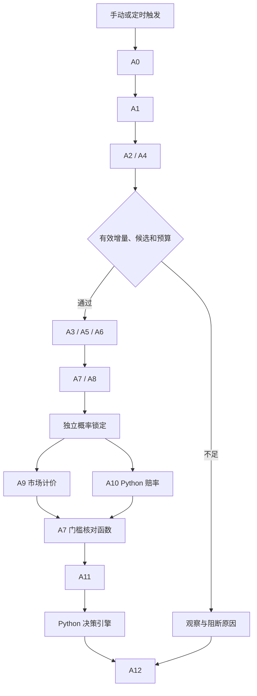

# V3.1 阶段 0 设计基线（补充约束合并版）

用户确认的实现基线，配合 V3.1-original-requirements.txt 和 stage0-amendments.md 阅读。

## 结构与数据流

Python 3.11+、FastAPI、Pydantic、SQLite、LangGraph、轻量调度、HTML/CSS/JS。后端承担计算和规则，浏览器展示及输入。Provider 独立适配鉴权、分页、格式、权限、时效和失败。新闻 Alpaca、行情 Alpaca、期权 Massive，独立搜索预留并首接 Brave。宏观和产业序列未来按需接 FRED/ALFRED、EIA。现货、期货、ETF 与对应期权分别保留 instrument_type、币种、单位、交易时区、合约期限和来源，代理关系显式存储。

重点行情池为 SPY、QQQ、IWM、AAPL、MSFT、NVDA、AMZN、META、GLD、USO、UNG、CPER。新闻按源覆盖和时间扫描，无代码必填限制，事件可反向关联池外资产。页面显示数据覆盖和代理口径。

## 逻辑模块输入输出

| 模块 | 输入 | 输出 |
| --- | --- | --- |
| A0 | 原始数据与游标 | 带时间、来源、哈希的证据版本与事件增量 |
| A1 | 行情特征、重大新闻 | 慢变量或离散事件候选、优先级 |
| A2 | 对齐价格、经济基准 | 分位、残差、相关、稳定性与结构突变 |
| A3 | 供需、政策、资本、技术 | 价值锚与迁移条件、反证 |
| A4 | 新旧主张及来源 | 独立事实、转载、矛盾和持续推进行为 |
| A5 | 供应、设施、运输、替代资料 | 瓶颈、实际缺口、恢复时间与受影响资产 |
| A6 | 主体、决定权、否决权、影响力 | 条件行动树、反制、缓解 |
| A7 | 独立证据与行动树 | 情景、时间和条件概率区间、未知与改判条件 |
| A8 | 价格、资金、库存、产量、政策 | 反馈回路和系统状态 |
| A9 | 期限结构、IV、偏斜、量仓 | 已计价程度和拥挤程度及缺口 |
| A10 | 独立概率快照、真实链、费用 | 成本、保本、最大损失、净期望和赔率门槛 |
| A11 | 反证、报价、期限、风险账本 | 阻断、停止加仓、退出与检查条件 |
| A12 | 输入清单、预测、计算、执行记录 | 时间审计、复核、案例评分与归因 |

## LangGraph 条件流程

不要求 13 次独立调用。日常规则预筛、低成本新闻结构化、因果推演和反证按需要合并。A7 概率调用不读取期权成本或门槛，先保存独立快照，之后执行门槛检查。概率改判须引用新增证据，保留历史版本。无增量不重复完整研究。

## 持久化和历史隔离

research.sqlite3 保存 events、evidence、event_versions，后续迁移增补市场观测、合约与报价、情景快照、信号历史、决策、模拟成交及游标。event_id 跨天稳定。证据记录原文或获准摘要、URL、来源类型、发生、首次公开、当前版本公开与获取时间。事实、矛盾、假设、权力、情景、上次完整输出和下一检查项保留版本，不覆盖历史证据。

cases.sqlite3 保存案例输入版本、轮次和预测快照。validation.sqlite3 保存独立验证版本，后续 A12 根据已锁定 run_id 访问。运行前确认每轮截止时间和可见证据清单，修订新闻、当前快照、未来轮次、验证文本均受访问边界过滤。模型既有历史知识须经过证据白名单约束和引用审计。无法安全切分时要求确认轮次。合成数据在独立测试目录。

runtime.sqlite3 保存配置引用、调用、连接状态、预算，后续加入任务、规则版本、审计和调度。密钥只由服务端敏感配置读取。LangGraph 实时、案例预测、评测分别使用独立 Checkpoint 文件，thread_id 为 run_id，业务记忆通过 event_id 读取。幂等键、事务、事件串行提交和游标原子更新处理重试及并发。

## 期权、风险与信号

首版标准单腿长 Call/Put。Python Decimal 计算每张成本、到期保本、归零损失和各情景收益。净期望为各情景概率乘净退出价值之和减成本。二元门槛为（成本减失败价值）除以（成功价值减失败价值），校验分母和可行性。情景互斥、穷尽，概率区间可行性及保守净期望通过 Python 校验。

分别记录事件发生、到期前发生、足够价格变化与目标退出的条件及联合概率。到期前理论价值与到期交割分开。真实 Bid/Ask、历史成交、理论估值和模拟成交单独标识。L3 必须通过新鲜真实报价、正保守期望、期限、流动性、风险额度和反证检查。缺真实数据只记录研究与缺口。L0 观察、L1 异常、L2 催化确认、L2.5 可算赔率待证优势、L3 模拟候选。R1 停追、R2 兑现研究、R3 原计划退出。模拟计划创建后才评估报价执行，独立记录成交假设。

## 开发顺序、预算与验收

1. 基础工程、迁移、三页、配置与真实探针。验收保存恢复、脱敏、错误提示。
2. 采集、去重、事件关联与跨天记忆。验收重复、修订、反证和重启恢复。
3. A1–A9 与 LangGraph 条件流。验收全池发现、池外发现、定向报告和无增量跳过。
4. A10–A12、真实期权、风险与信号。验收 Python 数学、报价质量、风险与模拟执行。
5. 案例分轮、锁定与独立验证。验收四轮合成案例、未来标记泄漏检查、评分归因。
6. 定时、补扫、缓存、预算、重试。验收并发幂等、服务离线状态与预算恢复。
7. 核心单测、集成和浏览器验收，备份恢复与使用文档。真实案例由用户提供。

阶段 1 只在主动模型探针时每次调用一次，通常小于 1K Token。后续每事件复杂研究预计 2–3 次、8–20K 输入输出 Token；验证每次 0–1 次、0–6K。无实质增量 0 次。默认每日 20 次 LLM、扫描最多 3 个深度候选，灵石区可调整。费用依模型、实报 Token、缓存和费率记录。调度默认关闭，后续每日增量、每周完整、重点事件独立周期。运行前原子预留预算，失败和重试计入调用。

开发推荐阶段 1 使用 GPT‑6.2 Sol 中等，记忆隔离、概率、期权及验收使用 GPT‑6.2 Astra 高。每阶段报告变更、交互、预算、实测和用户验收步骤。规则及 Prompt 的更改由用户确认。
